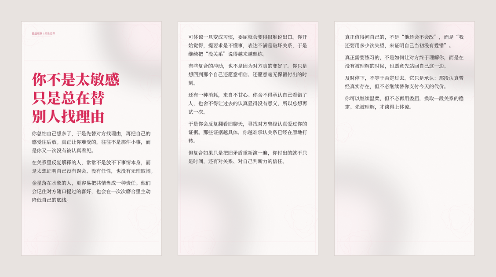

# Star Emotion Carousel

A Codex Skill for turning finished Chinese astrology or relationship copy into publish-ready Xiaohongshu image carousels.

It handles:

- 2–6 page editorial planning;
- six built-in visual styles;
- deterministic Chinese typography with Pillow;
- automatic or manual page breaks;
- overflow and content validation;
- title, caption, hashtags, alt text, and upload checklist;
- a publishing package with ordered PNG images.

Chinese text is never delegated to an image model. The renderer measures the installed fonts and places every line itself, which avoids wrong characters, pseudo-text, and inconsistent typography.

## Preview

### Six built-in styles


### Long-form three-page version



## Built-in Styles

| Style | Best for | Canvas |
|---|---|---|
| `blush-manuscript` | Relationship essays and long-form emotional copy | 1080 × 1800 |
| `nocturne` | Astrology analysis and night-thought content | 1080 × 1440 |
| `sage-letter` | Healing, self-growth, and gentle boundaries | 1080 × 1440 |
| `cobalt-grid` | Rankings, lists, and direct opinions | 1080 × 1440 |
| `ink-noir` | Mature, clear-eyed relationship analysis | 1080 × 1440 |
| `photo-veil` | A supplied ambient photo or text-free background | 1080 × 1440 |

## Install

Clone directly into the Codex skills directory:

```powershell
git clone https://github.com/zhaokangwei095/star-emotion-carousel.git `
  "$env:USERPROFILE\.codex\skills\star-emotion-carousel"
```

Install Pillow if your Codex runtime does not already include it:

```powershell
python -m pip install Pillow
```

## Use

Prompt Codex after the article is finished:

```text
使用 $star-emotion-carousel，把这篇正文做成三页小红书图文，
用“白桃式淡粉手稿”风格，最后给我发布文案和图片。
```

Or choose another direction:

```text
使用 $star-emotion-carousel，这篇内容偏清醒分析，选“墨黑清醒”。
```

## Scripts

List styles:

```powershell
python scripts/render_carousel.py --list-styles
```

Render the bundled example:

```powershell
python scripts/render_carousel.py `
  --input examples/sample_content.json `
  --out rendered
```

Render a style gallery:

```powershell
python scripts/render_carousel.py `
  --input examples/sample_content.json `
  --out style-gallery.png `
  --gallery
```

Validate and build a publishing package:

```powershell
python scripts/validate_carousel.py `
  --input examples/sample_content.json `
  --images rendered
```

```powershell
python scripts/package_publish.py `
  --input examples/sample_content.json `
  --images rendered `
  --out 发布包
```

## Content Boundaries

- Astrology is treated as culture, entertainment, and self-observation, not diagnosis or fate.
- Qualified language such as `更容易`, `常常`, and `在某种关系里` is preferred over absolute claims.
- Research, expert endorsements, statistics, or platform limits must not be invented.
- Real private conversations, names, faces, or account data must not be placed into images.

## License

MIT
