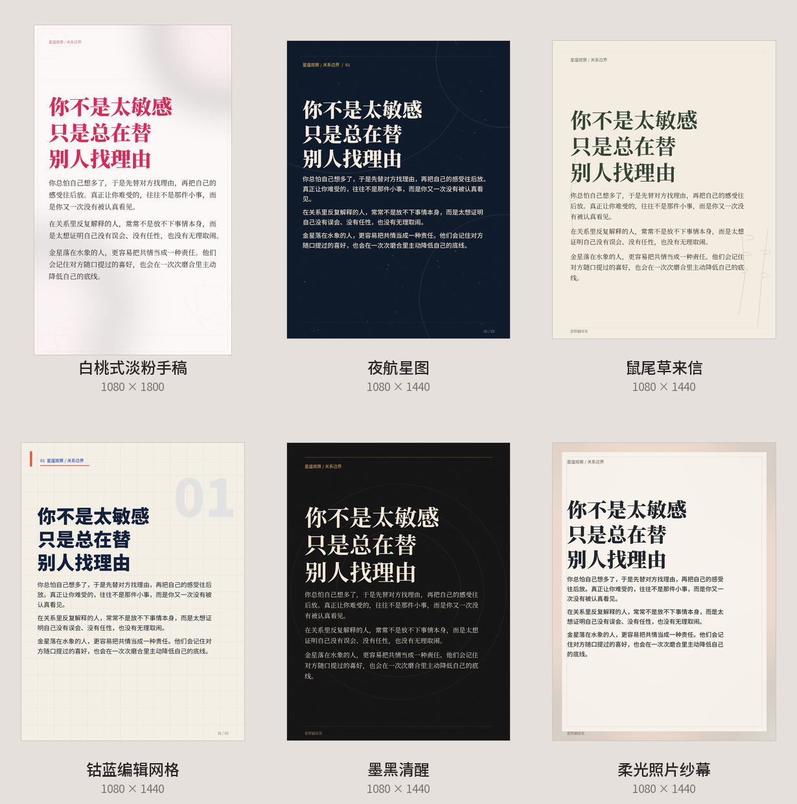

# Star Emotion Carousel

A Codex Skill for turning finished Chinese astrology or relationship copy into publish-ready Xiaohongshu image carousels.

It handles:

- 2–6 page editorial planning;
- one measurable focus statement per page, with a shorter kicker and supporting body;
- six built-in visual styles;
- optional text-free editorial backgrounds with a fixed upper-left reading zone;
- deterministic Chinese typography with Pillow;
- automatic or manual page breaks;
- overflow and content validation;
- title, caption, hashtags, alt text, and upload checklist;
- a publishing package with ordered PNG images.

This is not a prompt-only image workflow. The renderer enforces the information
hierarchy and measures the installed fonts before placing every Chinese line.
An image model can supply one atmospheric, text-free subject per page; it never
owns the title, focus statement, body copy, or layout.

## Published

- SkillHub: [星座情感图文工坊](https://skillhub.cn/skills/indiv-rv/star-emotion-carousel)
- Version: `1.1.1`

## Preview

### Six built-in styles



### Focus-led four-page version with text-free backgrounds


## Built-in Styles

| Style | Best for | Canvas |
|---|---|---|
| `blush-manuscript` | Relationship essays and long-form emotional copy | 1080 × 1800 |
| `nocturne` | Astrology analysis and night-thought content | 1080 × 1440 |
| `sage-letter` | Healing, self-growth, and gentle boundaries | 1080 × 1440 |
| `cobalt-grid` | Rankings, lists, and direct opinions | 1080 × 1440 |
| `ink-noir` | Mature, clear-eyed relationship analysis | 1080 × 1440 |
| `photo-veil` | A supplied ambient photo or text-free background | 1080 × 1440 |

`photo-veil` is a full-bleed photo treatment. The other presets can also use
`visual_mode: "editorial-background"` with one still-life background per page;
the renderer adds a stronger upper-left wash so the generated subject cannot
compete with the Chinese reading hierarchy.

## Install

Clone directly into the Codex skills directory:

```powershell
git clone https://github.com/zhaokangwei095/star-emotion-carousel.git `
  "$env:USERPROFILE\.codex\skills\star-emotion-carousel"
```

Install Pillow if your Codex runtime does not already include it:

```powershell
python -m pip install Pillow
```

## Use

Prompt Codex after the article is finished:

```text
使用 $star-emotion-carousel，把这篇正文做成三页小红书图文，
用“白桃式淡粉手稿”风格，最后给我发布文案和图片。
```

Or choose another direction:

```text
使用 $star-emotion-carousel，这篇内容偏清醒分析，选“墨黑清醒”。
```

## Scripts

List styles:

```powershell
python scripts/render_carousel.py --list-styles
```

Render the bundled example:

```powershell
python scripts/render_carousel.py `
  --input examples/sample_content.json `
  --out rendered
```

Render a style gallery:

```powershell
python scripts/render_carousel.py `
  --input examples/sample_content.json `
  --out style-gallery.png `
  --gallery
```

Render with one background per page:

```powershell
python scripts/render_carousel.py `
  --input examples/sample_content.json `
  --out rendered `
  --background-dir backgrounds
```

Validate and build a publishing package:

```powershell
python scripts/validate_carousel.py `
  --input examples/sample_content.json `
  --images rendered `
  --backgrounds backgrounds `
  --strict
```

Strict validation checks the focus hierarchy, text-safe visual briefs, and
the one-background-per-page contract in addition to image dimensions.

```powershell
python scripts/package_publish.py `
  --input examples/sample_content.json `
  --images rendered `
  --out 发布包
```

## Content Boundaries

- Astrology is treated as culture, entertainment, and self-observation, not diagnosis or fate.
- Qualified language such as `更容易`, `常常`, and `在某种关系里` is preferred over absolute claims.
- Research, expert endorsements, statistics, or platform limits must not be invented.
- Real private conversations, names, faces, or account data must not be placed into images.

## License

MIT
